# flow

flow is a spec-driven dev-workflow plugin for Claude Code. It takes a feature from a rough idea to reviewed code:
interview, spec, plan, tasks, execution, and review. It also ships docsmith documentation governance and
roadmap/issue-tracker sync.


| Section                                           | What it covers                             |
| ------------------------------------------------- | ------------------------------------------ |
| [Install](#install)                               | Adding the plugin                          |
| [One-time project setup](#one-time-project-setup) | Scaffolding docsmith and initializing flow |
| [The workflow](#the-workflow)                     | The end-to-end lifecycle as a diagram      |
| [Workflow steps](#workflow-steps)                 | What each lifecycle command does           |
| [Issue tracker setup](#issue-tracker-setup)       | Declaring your tracker in `roadmap.md`     |
| [Other skills](#other-skills)                     | Skills outside the main lifecycle          |
| [Documentation commands](#documentation-commands) | docsmith write, update, and fix commands   |
| [Agent](#agent)                                   | The bundled subagent                       |
| [Hooks](#hooks)                                   | What runs automatically                    |


## Install

```
claude plugin marketplace add /Users/tushar/Documents/tushar2708/claude-assets
claude plugin install flow@claude-assets --scope user
```

> **Note — recommended companion plugin.** flow assigns a language-specific agent to each task, based on the
> type of file the task changes. For React files (`.tsx`, `.jsx`, React `.ts`) it uses
> `react-atomic-aesthetics:implementer`, which comes from a separate plugin. Installing it is not mandatory:
> without it, React tasks run in the main conversation instead. But it is recommended if you build React UI.
>
> Install it from the same marketplace:
>
> ```
> claude plugin install react-atomic-aesthetics@claude-assets --scope user
> ```

## One-time project setup

1. Run `/flow:init`. It scaffolds or refreshes `.docsmith/`, initializes `roadmap.md` and its local tracker declaration,
 writes the Flow block in `AGENTS.md`, and links `CLAUDE.md` to `AGENTS.md` where appropriate.

`/flow:spec` stops and asks you to run `/flow:init` when docsmith is not set up.

## The workflow

```mermaid
flowchart TD
    idea([Feature idea]) --> grill

    subgraph G["/flow:grill — research-backed interview"]
        direction TB
        grill["Map the feature's concepts<br/>in four domains"]
        domains["Architecture · Product · UI/UX · Business"]
        research["Optional web research per chosen domain:<br/>best practices and pitfalls<br/>saved to research-output.md"]
        rounds["Interview in rounds<br/>(up to 4 questions per round)"]
        open{"Open decisions<br/>left?"}
        converge["Shared understanding:<br/>decisions, adopted practices,<br/>avoided pitfalls, open risks"]
        grill --> domains --> research --> rounds --> open
        open -- yes --> rounds
        open -- no --> converge
    end

    %% Main path. Declared first so it stays in the central column.
    converge -->|you confirm the summary| spec["/flow:spec<br/>Write a numbered, validated spec<br/>docs/specs/spec-NN-use-case/spec-NN-use-case.md<br/>with ordered sub-features SF-1..n"]
    %% Hidden spacer on the left balances the optional branch on the right, so spec stays above plan-it.
    spec ~~~ spacer["/flow:add-to-roadmap<br/>Story + one Subtask per sub-feature<br/>in your tracker"]:::hidden
    spec --> planit["/flow:plan-it (Plan Mode)<br/>One wave per sub-feature<br/>Stages: S1 contracts → S2 tests → S3 implementation<br/>Verify gate after every wave<br/>Also applies any planning skills you name"]
    planit --> prehook{{"ExitPlanMode pre-hook — nudge<br/>Before approval: reminds the agent to verify the plan<br/>against the skills that built it.<br/>Non-blocking; a compliance marker silences it"}}
    prehook -->|you approve the plan| hook{{"ExitPlanMode post-hook<br/>After approval: checks the plan against<br/>your project rules, then triggers make-tasks"}}
    hook --> maketasks["/flow:make-tasks<br/>(auto, or run it manually)<br/>Tasks in wave → stage → task order<br/>with blockedBy wiring. And all tasks created with a common prefix tag (say. [fancy-feature])"]
    maketasks --> execute

    subgraph E["/flow:execute"]
        direction TB
        execute["/goal implement all the tasks with the tag [fancy-feature]<br/>with their planned agent"]
        verify{"Verify gate<br/>(you choose: run or skip)"}
        close["Close task (only with a tracker)<br/>Comment on the sub-feature's Subtask<br/>and mark it Done"]
        next{"More waves?"}
        execute --> verify --> close --> next
        next -- yes --> execute
    end

    next -- no --> review["/flow:review<br/>Read-only review of the implementation<br/>against the plan's skills"]
    review --> done([Reviewed code])

    %% Note bubble for the close task. Declared after the main path so it sits to the right.
    close -.- closenote["Runs only if the sub-feature has a Subtask,<br/>created by /flow:add-to-roadmap.<br/>The tracker is the one declared in roadmap.md<br/>(Jira, GitHub, Asana, or other).<br/>Posts a comment with what the wave built,<br/>then sets the Subtask to Done.<br/>If you skipped the verify gate, it asks first."]:::note

    %% Optional branch. Declared last so it sits beside the main path.
    spec -. optional .-> roadmap["/flow:add-to-roadmap<br/>Story + one Subtask per sub-feature<br/>in your tracker"]
    roadmap -.-> tracker[("Tracker<br/>Jira · GitHub · Asana · other")]
    roadmap -.-> rmfile[["roadmap.md<br/>in your project"]]

    classDef hidden fill:none,stroke:none,color:transparent
    classDef note fill:#fff8c5,stroke:#d4a72c,color:#1f2328,stroke-dasharray:4 3
```



Dashed arrows are optional. They need a declared tracker and a reachable MCP server (or `gh` for GitHub).

## Workflow steps


| Step | Command                | What it does                                                                                                                                                                                                                                                                                                                                      |
| ---- | ---------------------- | ------------------------------------------------------------------------------------------------------------------------------------------------------------------------------------------------------------------------------------------------------------------------------------------------------------------------------------------------- |
| 1    | `/flow:grill`          | Maps the feature's concepts across architecture, product, UI/UX, and business. Asks whether to research the web, and which domains. It saves each finding with its source, a recommendation and an empty decision column to `research-output.md` in the spec's folder, or records that you declined research. Then interviews you in rounds until no decision is open. Ends with a summary that you confirm.                                                                                                                |
| 2    | `/flow:spec`           | Writes the discussion into a spec, with no new interview. The spec lists ordered sub-features (`SF-<n>`), each with behavior, user stories, dependencies, and done-when criteria. It is saved as `docs/specs/spec-NN-<use-case>/spec-NN-<use-case>.md` and validated by docsmith.                                                                                               |
| 2a   | `/flow:add-to-roadmap` | Optional. Creates one Story under an epic and one Subtask per sub-feature in your tracker, and records them in `roadmap.md`. `/flow:spec` offers to run it for you. Run without a spec, it creates one item.                                                                                                                                      |
| 3    | `/flow:plan-it`        | In Plan Mode, turns the spec (or the session) into a wave plan: one wave per sub-feature, each with contract, test, and implementation stages, a verify gate, and a close task when the sub-feature has a tracker Subtask. It also invokes any planning skills you name, and the skills they require, and records how each of their rules is met. |
| 4    | `/flow:make-tasks`     | Runs automatically after you approve the plan, or when you call it. Validates the plan, then creates the tasks in wave → stage → task order and wires their dependencies. It makes no design decision.                                                                                                                                            |
| 5    | `/flow:execute`        | Runs the tasks stage by stage with each task's planned agent, and checks every changed file. After each wave it asks whether to run the verify gate. When a wave's sub-feature has a tracker Subtask, it comments on it and moves it to Done. A Subtask that needs a test result from you stays open until you report it.                         |
| 6    | `/flow:review`         | Reviews the implementation read-only. It first finds the skill that created the plan and checks the work against it, then reviews the code.                                                                                                                                                                                                       |


flow never commits. You commit when you choose to.

## Issue tracker setup

The tracker is declared in an `## Issue Tracking` section of your project's `roadmap.md`. The first tracker
command asks for it when the section is missing.


| Field      | Value                                                                                                                     |
| ---------- | ------------------------------------------------------------------------------------------------------------------------- |
| Tool       | `github`, `jira`, `asana`, or `other:<name>` (for example, Linear)                                                        |
| Location   | GitHub `repo=<owner>/<name>`; Jira `site=<host>; project=<KEY>`; Asana `workspace=<gid>; project=<gid>`; other: free text |
| MCP server | The MCP server to use, for example `atlassian` or `claude_ai_Asana`. For GitHub, `none` uses the `gh` CLI.                |


`/flow:sync-issues` reconciles `roadmap.md` with the tracker. It backfills missing items, repairs links, and
syncs status, and it never creates a duplicate.

## Other skills


| Skill                   | Use it to                                                                                                                                   |
| ----------------------- | ------------------------------------------------------------------------------------------------------------------------------------------- |
| `/flow:grilling`        | Stress-test a plan, decision, or idea in a quick interview, with no research phase. The model can also start it when you ask to be grilled. |
| `/flow:prototype`       | Build a throwaway prototype to answer a design question about logic, state, or UI.                                                          |
| `/flow:diagnosing-bugs` | Run a diagnosis loop for a hard bug or a performance regression.                                                                            |
| `/flow:handoff`         | Compact the conversation into a handoff document for the next session.                                                                      |
| `/flow:explaining-code` | Produce HTML documentation with diagrams that explains a feature, a subsystem, or a repository, with each claim traced to a file and line.  |
| `/flow:sync-issues`     | Reconcile `roadmap.md` with the declared tracker.                                                                                           |
| `flow:docs`             | The docsmith engine and rules. Used by the documentation commands and hooks.                                                                |


## Documentation commands


| Command              | Use it to                                                                                                |
| -------------------- | -------------------------------------------------------------------------------------------------------- |
| `/flow:write-doc`    | Write a doc in a docsmith category: tutorial, how-to, reference, explanation, or runbook.                |
| `/flow:write-adr`    | Write an architecture decision record with numbering and a supersede chain.                              |
| `/flow:write-prd`    | Write a product requirements document.                                                                   |
| `/flow:update-docs`  | Process pending `[docsmith] update ...` tasks: check claims against the code and rewrite stale sections. |
| `/flow:fix-findings` | Run docsmith validation and fix every finding.                                                           |


Each command validates its output until docsmith reports no failures.

## Agent


| Agent                      | Role                                                                                                                            |
| -------------------------- | ------------------------------------------------------------------------------------------------------------------------------- |
| `flow:docsmith-doc-author` | Writes one documentation file to its category template and validates it to green. Every flow command that writes a doc uses it. |


## Hooks


| Event                                     | What happens                                                                                                                               |
| ----------------------------------------- | ------------------------------------------------------------------------------------------------------------------------------------------ |
| After a file edit                         | When the edited code is mapped in `.docsmith/docmap.json`, flow reminds you to update the docs that describe it.                           |
| Before a plan is finalized (`ExitPlanMode`, pre-tool) | If the plan carries a `Planned-with-skill:` stamp, flow nudges you to re-verify it against that skill's rules before approval. Non-blocking; a `Skill-compliance: verified` marker in the plan silences it. |
| After you approve a plan (`ExitPlanMode`, post-tool) | flow checks the plan against your `CLAUDE.md`, `AGENTS.md`, and `.claude/rules/`, asks about each violation, then runs `/flow:make-tasks`. |


