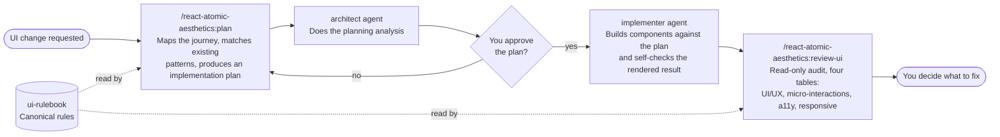

# react-atomic-aesthetics

react-atomic-aesthetics is a Claude Code and Codex plugin for building React UI. It holds one canonical set of UI/UX
and atomic-structure rules, and a planner, an implementer, a plan skill and a review-ui skill that all follow those
rules. Use it to plan a UI change before writing code, implement it, and audit the result.

| Section | What it covers |
|---|---|
| [Install](#install) | Adding the plugin |
| [How it fits together](#how-it-fits-together) | Plan, implement, review |
| [Skills](#skills) | What each skill does and when to call it |
| [Agents](#agents) | The planner and implementer agents |
| [The rulebook](#the-rulebook) | What the rules cover |
| [Supported hosts](#supported-hosts) | Where the plugin works |

## Install

The plugin ships in the `claude-assets` marketplace. Install it with the repository installer, which installs every
plugin:

```sh
curl -fsSL https://raw.githubusercontent.com/tushar2708/claude-assets/main/install.sh | bash -s -- --claude
```

To install only this plugin, add the marketplace once and install the plugin:

```sh
claude plugin marketplace add tushar2708/claude-assets
claude plugin install react-atomic-aesthetics@claude-assets --scope user
```

Restart Claude Code or run `/reload-plugins` afterwards.

## How it fits together



The planner and the reviewer both read the rulebook first. The implementer builds to the approved plan.

## Skills

| Skill | Use it to |
|---|---|
| `/react-atomic-aesthetics:plan` | Plan a new UI feature, page or component, or a redesign, before coding. Not for bug fixes or copy-only or rename edits. |
| `/react-atomic-aesthetics:review-ui` | Audit an existing or just-built React UI. Pass an optional path, route, screen or component to limit the scope. The audit never changes code. |
| `/react-atomic-aesthetics:ui-rulebook` | Load the canonical rules directly, for example before you write or review UI code yourself. |

## Agents

| Agent | Role |
|---|---|
| `react-atomic-aesthetics:architect` | Plans a UI change: user journeys, component hierarchy and aesthetic direction, checked against the existing codebase. |
| `react-atomic-aesthetics:implementer` | Implements or reviews JSX/TSX + Tailwind + shadcn/ui + lucide-react code against an approved plan. |

Agents cannot start other agents. The `plan` and `review-ui` skills call the architect and implementer for you.

## The rulebook

The rules live in one place, the `ui-rulebook` skill. They are grouped into parts:

| Part | Covers |
|---|---|
| A | Aesthetic discipline: colour, type, whitespace, depth, layout, states, motion, and accessibility |
| B | Atomic structure: component classification, styling approach, design tokens, the `INDEX.md` inventory |
| C | Dependency requirements |
| D | Role checklists for the architect, implementer and reviewer |
| E | Decorative content, ambient motion and micro-interactions |
| F | Verification discipline: never assume a convention or token exists without reading it |

Every plan and review cites the rule numbers it applies. The rules also ask a project to keep an `INDEX.md`, and the
plugin ships a template for it.

## Supported hosts

The plugin works in Claude Code and Codex. In any other host, the skills tell you they have no validated integration
there.
